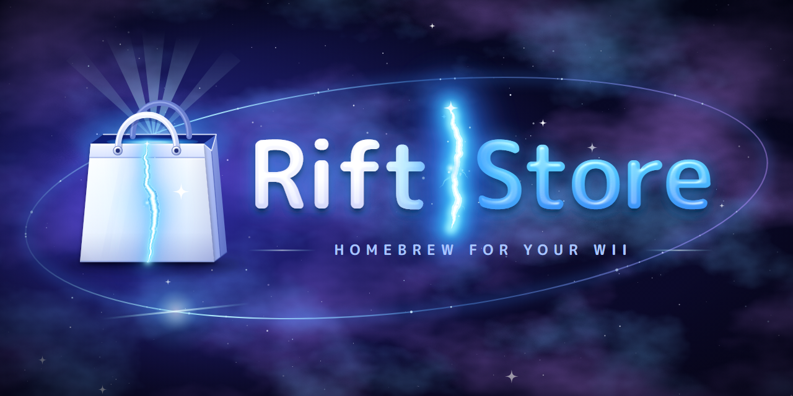

# Rift Store

The list of homebrew apps in the **Rift Store**, the store built into
[RiftWii](https://github.com/KakarottoCake/Riftwii) (Settings > Online >
Rift Store). Each app is one small manifest in `apps/`. GitHub Pages
publishes the list as **https://riftwii.github.io/apps/apps.json**, with
each app's icon beside it.

No app is hosted here. The list points at each app's own release file, on
GitHub or on its author's site, and pins it by its SHA-256, so a Wii only
installs the exact file a maintainer approved.

The format, and what RiftWii accepts, is in RiftWii's
[docs/APPSTORE.md](https://github.com/KakarottoCake/Riftwii/blob/main/docs/APPSTORE.md).

## Add an app

**The step-by-step guide is [CONTRIBUTING.md](CONTRIBUTING.md)** (also the
pinned issue). In short:

1. Read [CONTENT-RULES.md](CONTENT-RULES.md).
2. Add `apps/<id>.json` (start from a similar app's file). For a GitHub
   release, give `source.github` and `source.asset`; RiftWii's
   `tools/app_list.py update apps <id>` writes the `pin`.
3. Open a pull request. The **validate** check downloads the pinned file,
   checks it against its pin and its install rules, and reads the whole list
   back with the Wii's own parser. A maintainer reviews the app; once it is
   merged, **publish** adds it to the list within a few minutes.

## New versions

**update** runs once a day: it pins every GitHub app to its newest release
and opens one pull request, "New app releases". Nothing reaches players
until a maintainer merges it. (A pull request opened by a workflow does not
start other workflows: run **validate** on it by hand, or push to its
branch.)

Apps whose authors publish no builds can be built by a nightly fork in the
RiftWii organization: it follows the app's main branch, builds it when
something new lands there, and publishes each build under its own tag
(`nightly-YYYY-MM-DD-<commit>`). Its manifest sets `"prerelease": true`.

## Categories

`games`, `emulators`, `media`, `internet`, `online` (online services),
`gametools`, `loaders`, `system`, `wiimenu`, `controllers`, `creative`,
`toys` (demos and toys).

## Logo

`docs/rift-store.png` (1280x640), `docs/rift-store-wide.png` (1600x400) and
`docs/rift-store-mark.png` (the bag, 512x512), drawn by RiftWii's
`tools/store_logo.html`.

## License

The manifests are GPL-3.0-or-later, like RiftWii ([COPYING](COPYING)).
Each app keeps its own license; the list only links to it.
